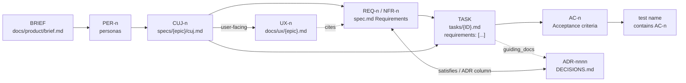

# Contracts

The harness defines the files every layer reads and writes, so that engines (Claude Code, Codex,
Gemini), runtimes (a CLI loop, CI agents, stagehand on Herdr) and methods can be swapped without
touching the others. A contract is a JSON Schema 2020-12 file in `schemas/`, versioned with
`x-version`; the state machines that govern the status fields are in `state-machines/`; the
validator is `tools/validate.mjs`. Layers are explained in [LAYERS.md](LAYERS.md).

```
node tools/validate.mjs <file|dir>...           # each file against the contract its path implies
node tools/validate.mjs --contract task <file>  # against a named contract
node tools/validate.mjs --trace <project-root>  # the trace graph, per epic, with a verdict
node tools/validate.mjs --list                  # contracts, versions, artifact paths
```

## Conventions all contracts share

- **Artifacts** are Markdown with YAML frontmatter unless a contract says YAML, JSON or JSONL. The
  schema validates the frontmatter (or each parsed entry); required level-2 body headings are listed
  under `x-sections`, matched case-insensitively by prefix.
- **Where** an artifact lives is `x-artifacts` in its schema: a format, path globs relative to the
  project root, and `bind` rules that tie a frontmatter field to a path segment (a task's `id` must
  equal its file name; its `epic`, its folder). The validator infers a file's contract from these
  paths, or from `fixtures/{valid,invalid}/<contract>/`.
- **Rules have names.** Conditional rules carry `x-rule`; errors report that name, a JSON pointer,
  and a file line. Rules JSON Schema cannot express are named checks listed in `x-checks`
  (`tools/lib/checks.mjs`). Unknown fields are errors, except `x-*` keys, which are free for local
  extensions.
- **Ids.** `BRIEF`, `PER-n`, `CUJ-n` and `REQ-n`/`NFR-n` (per epic), `UX-n`, `ADR-nnnn`,
  `<PREFIX>-n` for tasks, `AC-n` per task, `GRANT-n`. A reference across epics is `<epic>/CUJ-n` or
  `<epic>/REQ-n`; within an epic the bare id is enough. ADRs belong to no epic, so they always qualify.
- **Shared definitions** (ids, dates, status enums, `budget`, `sessionRef`, `traceGap`) are in
  `common.schema.json` and referenced with `$ref`.
- **Versioning.** Each schema started at `1.0.0` and carries its own `x-version`
  (`validate.mjs --list` prints them). A change that makes a valid artifact invalid is a major
  bump; a new optional field or enum value is minor. The harness is pre-1.0 as a whole (README).

## Catalogue

| Contract | Artifact (in an L2 project unless noted) | Format | Producer | Consumers |
|---|---|---|---|---|
| [brief](#brief) | `docs/product/brief.md` | frontmatter-md | product owner | planner, trace check |
| [persona](#persona) | `docs/product/personas.md` or `personas/<slug>.md` | entries / frontmatter-md | product owner | journeys, trace check |
| [journey](#journey) | `specs/<epic>/cuj.md` entries | entries | product owner, planner | planner, tasks, trace check |
| [requirement](#requirement) | `specs/<epic>/spec.md` Requirements tables | table rows | product owner | tasks, ADRs, trace check |
| [ux-flow](#ux-flow) | `docs/ux/<epic>.md` entries | entries | designer | coder, trace check |
| [decision](#decision) | `DECISIONS.md` (or `docs/adr/*.md`) entries | entries | anyone, reviewed | everyone; trace check |
| [epic](#epic) | `specs/<epic>/spec.md` frontmatter | frontmatter-md | product owner | board, planner, trace check |
| [task](#task) | `specs/<epic>/tasks/<ID>.md` | frontmatter-md | planner | board, loop, coder, reviewer, merge |
| [readiness-report](#readiness-report) | `specs/<epic>/readiness.md` | frontmatter-md | trace check (generated) | product owner at the spec gate |
| [task-record](#task-record) | `.orchestrator/tasks/<id>.yaml` (runtime) | YAML | coordinator | coordinator, status board |
| [return](#return) | a subagent's hand-back | JSON | subagent | dispatcher |
| [run-record](#run-record) | `.agent/loop-runs.jsonl` (runtime, gitignored) | JSONL | runner | humans, cost reports |
| [grant](#grant) | `.orchestrator/grants/GRANT-n.yaml` | YAML | a human | coordinator |
| [policy](#policy) | `agent-policy.yaml` (L1 dotfiles) | YAML | operator | policy compiler → engine settings |
| [toolkit-lock](#toolkit-lock) | `toolkit.lock` (L1 and L2) | YAML | lock tool | sync, CI |
| [skill](#skill) | `skills/<name>/SKILL.md` (L3, L4) | frontmatter-md | skill author | every engine's skill loader |
| [evidence](#evidence) | `skills/<name>/evals/{evidence.md,routing.jsonl}` | entries / JSONL | skill author, eval runs | skill reviews, routing evals |

`common` holds the shared definitions and is not an artifact.

---

### brief

**Purpose.** The root of the trace graph: problem, users, outcomes, non-goals, and the personas the
product commits to. One per product. **Schema** `schemas/brief.schema.json` 1.0.0; `id: BRIEF`,
`product`, `owner`, `status` (draft | approved | superseded), `updated`, `personas[]`, `links[]`;
sections Problem, Users, Outcomes, Non-goals. **Swap story.** The brief can be written by hand, by an
interview skill, or exported from a product tool; the trace check only reads this file. **Compat.**
agentic-template has no brief; `docs/01-*` chapters hold similar prose. Its absence switches the
trace check to legacy adoption (below).

### persona

**Purpose.** A user the brief serves; journeys cite personas. **Schema** `persona.schema.json`
1.0.0: `id` PER-n, `name`, `role`, `goals[]` (≥1), optional `pains`, `context`, `quote`,
`evidence[]`. **Location.** Either one `docs/product/personas.md` with `## PER-n · Name` entries and
`- **Role:** …` / `- **Goals:**` bullets, or one frontmatter file per persona under `personas/`.
**Swap story.** Personas from research tools, interviews or analytics land in the same shape.
**Compat.** New in the harness.

### journey

**Purpose.** A Critical User Journey: one end-to-end path that must work, the source of a task's
event, state and unwanted-behaviour criteria. **Schema** `journey.schema.json` 1.0.0: `id` CUJ-n,
`title`, `epic` (from the path), `actor`, `goal`, `trigger`, `success`, `unwanted`, optional `steps[]`,
`personas[]`, `user_facing`, `extra{}`. **Swap story.** Journeys can be drafted by a product owner, a
planner agent or a design tool; tasks reference them only by id. **Compat.** Describes
agentic-template's `cuj.md` unchanged (both epics validate as-is). New optional bullets:
`- **Personas:** PER-1` and `- **User-facing:** yes|no`.

### requirement

**Purpose.** One checkable behaviour (functional, REQ) or one measurable quality (non-functional,
NFR) of an epic; tasks implement requirements and ADRs satisfy them. **Schema**
`requirement.schema.json` 1.0.0: `id`, `source_id`, `epic`, `kind`, `statement`, `ears` (set by the
parser), `module`, `verified_by`, `cujs[]`, `adrs[]`; an NFR also requires `category` (performance,
security, …) and `measure`. **Swap story.** A requirements tool can export the same rows; tasks cite
ids, not text. **Compat.** Describes agentic-template's `| # | Requirement | Module | Verified by |`
table; legacy `R<n>` ids normalize to `REQ-<n>` (Normalization).

### ux-flow

**Purpose.** The screens of a user-facing journey and its four states (empty, loading, error,
success), designed before code, with a prototype link. **Schema** `ux-flow.schema.json` 1.0.0: `id`
UX-n, `title`, `epic`, `cujs[]` (≥1), `requirements[]`, `steps[]`, `states{empty,loading,error,success}`,
`prototype` (inherited from the file's frontmatter), `accessibility`. **Swap story.** The prototype
may live in any design tool; only its link is in git. **Compat.** New; agentic-template's
`docs/design.md` is the visual language, not per-flow design.

### decision

**Purpose.** An Architecture Decision Record: the immutable why, the options rejected, whether the
door is one-way, what would reverse it, and the requirements it satisfies. **Schema**
`decision.schema.json` 1.0.0: `id` ADR-nnnn, `title`, `status` (proposed | accepted | superseded |
deprecated | rejected), `status_text`, `superseded_by[]`, `refined_by[]`, `date`, `supersedes`,
`supersedes_ids[]`, `decision`, `why`, `consequences`, optional `options[]`, `door`,
`reversal_trigger`, `satisfies[]` (`<epic>/REQ-n`), `extra{}`, `placeholders[]`. Rules: a superseded
ADR names its successor; a one-way door names its reversal trigger; a date is required unless still
the template's `TODO(domain)` (warning). **Swap story.** One `DECISIONS.md` or one file per ADR under
`docs/adr/`; the parser reads both. **Compat.** Describes agentic-template's format (`## ADR-NNNN:
title`, `**Status:**`, `**Date:**`, `**Decision:**`, `**Why:**`, `**Consequences:**`, and the newer
`**Supersedes:**`, `**Reversed when:**`); all 18 ADRs validate unchanged.

### epic

**Purpose.** The planning-layer state machine of `spec.md` (intake → scoping → draft → approved →
in-progress → done; blocked). Not in the brief's table; added so the epic status is checked the
same way as the task status. **Schema** `epic.schema.json` 1.1.0: agentic-template's spec
frontmatter exactly (`epic`, `status`, `priority`, `size`, `business_value`, `initiative`, `owner`),
`owner` required from `approved` on, plus the optional harness field `mode`, the default methodology
of the epic's tasks (a task's own `mode` overrides it; absent everywhere, `spec-driven`); sections
Problem, Scope, Requirements, Tasks, Acceptance. The trace check reports each task's effective mode
(`--json`: `epics[].task_modes`) and an override of the epic's mode as `info`. **Compat.** Both
template epics validate unchanged.

### task

**Purpose.** One unit of work, the coordination substrate: the frontmatter is the kanban column and
the claim lock; the body is the contract the coder builds against. **Schema** `task.schema.json`
1.1.0. Required (agentic-template's fields, same meaning): `id`, `epic`, `status`, `priority`, `cuj`,
`guiding_docs`, `branch`, `depends_on`, `owner`. Optional template fields: `parent`, `size`,
`kickback_reason`. **Optional harness fields:**

| Field | Meaning |
|---|---|
| `requirements` | REQ/NFR ids this task implements; the trace check wants ≥1 |
| `touches` | path globs it expects to modify; overlapping tasks are one lane |
| `inputs` | paths or `{name, kind: file|secret|service|decision|data, ref, provided_by}` it needs first |
| `risk` | `low|medium|high` or `{level, irreversible, reasons}`; high/irreversible never runs unsupervised |
| `evaluator` | ordered `{kind: tests|script|agent-review|human|eval, ref}` that decide "met" |
| `budget` | `{max_turns, max_usd, max_minutes, max_tokens}` for the whole task |
| `sessions` | `sessionRef[]` the agent appends in its handoff (the runner never writes the task file) |
| `mode` | spec-driven, research-plan-implement, ralph-loop, icm-pipeline; absent: the epic's `mode`, else spec-driven |

`cuj` additionally accepts a list (`cuj: [CUJ-1, CUJ-2]`). Rules: a claimed task (in-progress,
review, human-review, merging) has an owner; `id` equals the file name and `epic` the folder;
criteria are `AC-n`, unique, EARS-shaped (the same five patterns as agentic-template's
`ears-lint.mjs`); no self-dependency; sections Context, Acceptance criteria, Open questions, Agent
log. **Swap story.** Any runtime that can read Markdown frontmatter can dispatch work: the
claude-cli loop, CI agents, stagehand, or a future PM-tool sync (as a projection, never an
authority). **Compat.** **All ten real task files** (BILL-1..4, TMIG-1..6) validate unchanged;
three are copied byte-for-byte into `fixtures/valid/task/real-*.md` and a test re-checks them against
their sources.

### readiness-report

**Purpose.** The trace check's verdict on one epic, generated for the product owner at the spec gate.
**Schema** `readiness-report.schema.json` 1.0.0: `epic`, `generated_at`, `generator`,
`source_commit`, `adoption` (full | legacy), `epic_status`, `verdict` (ready | not-ready), `counts`,
`coverage` (journeys with a task, requirements with a task, tasks citing a requirement, criteria
named in a test, each `{covered,total}`), `gaps[]` (`traceGap`); a `ready` verdict has no error and
no gap that blocks readiness. Written by `validate.mjs --trace <root> --readiness <dir>`; never
hand-edited. **Compat.** New.

### task-record

**Purpose.** A runtime's recovery note for one task: what a replacement coordinator needs to resume
(repository, worktree, agents, native session ids, PRs, attention, next action, human decisions).
**Schema** `task-record.schema.json` 1.1.0; `state.name` is attention (working | needs-human |
complete), never a workflow status; needs-human requires `next_action`; complete forbids it.
Harness additions: `runtime`, `grant`, `signals{role: {source, value, observed_at}}` (source: an
`attention.yaml` vocabulary — herdr, a2a, mcp-tasks, claude-headless, loop-outcome, ci — or
codex-exec, forgejo, gitlab, other), structured `reviews[]` and `decisions[]`, `resources` (the
worktree's derived `slug`, `worktree_path`, `database`, `ports{slot,first,last}`, `caches`,
`services`, the last cleanup `audit{at, result: passed|blocked, blocked_by}` and
`worktree_removed_at`, which requires an audit that passed), `updated_at`. **Swap story.** A different runtime (a CLI loop, a CI
orchestrator, stagehand) keeps the same note; a coordinator can be replaced mid-task. **Compat.**
A superset of stagehand's `assets/task-record.yaml`, which validates unchanged; the field map is in
[adapters/herdr](adapters/herdr/README.md).

### return

**Purpose.** A subagent's hand-back: a bounded summary (8,000 characters, about 2k tokens), the
artifact paths it wrote, its attention, the decisions it needs, and each acceptance criterion met
or unmet with a reason. needs-human requires at least one question; complete requires no unmet
criterion. **Schema** `return.schema.json` 1.1.0; `task` is the workflow id (`<PREFIX>-<n>`) when
the work has one, otherwise the runtime's stable id, as `task-record.task_id` accepts (a review of
an outside PR, a delegated job). **Swap story.** Any engine's structured output
(`claude -p --json-schema`, a Codex output schema) or a JSON file; the dispatcher reads paths, not a
transcript. **Compat.** stagehand deliberately uses no worker JSON (it reads the pane); the return
is optional there.

### run-record

**Purpose.** One JSON line per agent run, appended by the runner. **Schema** `run-record.schema.json`
1.0.0: exactly `scripts/loop.mjs`'s line — `task`, `session_id`, `started_at`, `ended_at`, `exit`
(code or signal), `outcome` (advanced | stalled | failed), `reason`, `subtype`, `num_turns`,
`total_cost_usd`, `status_after` — with null where loop.mjs writes null. Harness optional fields:
`engine`, `runtime`, `model`, `status_before`, `permission_mode`, `permission_denials`, `attention`,
`budget`, `grant`. Rules: failed and stalled carry a reason, advanced does not; advanced means the
task left ready/in-progress; ended ≥ started. **Compat.** Lines from loop.mjs's own test runs are the
fixture `fixtures/valid/run-record/loop-mjs-outcomes.jsonl`.

### grant

**Purpose.** A human delegating named decisions to a coordinator for a named scope, within limits,
until an expiry (`state-machines/authority.yaml`). **Schema** `grant.schema.json` 1.0.0: `id`,
`granted_by`, `granted_to{role, agent, runtime}`, `granted_at`, `source`, `scope{objective,
repositories, epics, tasks, requirements, non_goals}`, `actions[]`, `limits{max_workers, budget,
stop_when}`, `expires_at`, `revocable: true`, `revoked_at/by/reason`, `narrowed[]`. Actions:
`select-tasks`, `approve-plan`, `dispose-findings` (with a `policy`), `finalize`, `publish-review`,
and `merge{repo, target, strategy, requires}` where `requires` must include `independent-review` and
`required-checks`; only an orchestrator or the merge role may hold merge. **Swap story.** Lets a
coordinator (stagehand, a CI orchestrator, a future agent) stand in for named human decisions with an
auditable, expiring record instead of a remembered chat line. **Compat.** stagehand's
project-delegation grants map field by field ([adapters/herdr](adapters/herdr/README.md)); the
harness adds a mandatory expiry.

### policy

**Purpose.** The operator's (L1) agent policy: autonomy tier per machine profile, what is never read
(`deny_read`), never done (`forbid`), asked about (`ask`), pre-approved (`allow`), network `egress`,
`sandbox`, and run `budgets`; compiled per engine. **Schema** `policy.schema.json` 1.1.0. Tiers:
read-only, ask, auto-edit, autonomous, unattended (an unattended profile requires
`budgets.unattended`). A profile may name `requires`: preconditions the operator keeps outside the
policy (`prod-unreachable-from-this-host`, `non-root-container`); the bypass tier (autonomous)
must name them (a validation warning, a compile error) and the compiler passes them to the launcher
in `runner.json`. A rule has exactly one matcher: `command` (argv prefix, with alternatives),
`write` (path glob) or `tool` (web-fetch with a domain, web-search, `mcp:server[:tool]`). An `allow`
or `ask` that a `forbid` covers is a warning (it never takes effect). `accept_gaps` records the
degradations the operator accepts. **Swap story.** One policy, three engines: the compiler emits
Claude settings, Codex config + execpolicy rules, Gemini settings + policy TOML; per-engine maps and
gaps are in `adapters/{claude,codex,gemini}/README.md`. **Fail closed:** an unrepresentable deny is
a compile error unless accepted with a reason; an unrepresentable ask is dropped with a warning. The
bypass tier also needs the policy's own isolation (`sandbox.enabled`, `fail_if_unavailable`,
`egress.default: deny`) or, where the host is isolated another way, that field's gap accepted by
name; its `requires` is never waivable.
**Compat.** The dotfiles' `settings.json.tmpl` is restated as the valid fixture.

### toolkit-lock

**Purpose.** Pins the exact harness and L4 packs a project (or the dotfiles) runs. **Schema**
`toolkit-lock.schema.json` 1.0.0: `lock_version`, `entries[]` of `{name, layer (L3|L4), kind,
source, path, ref, commit (full sha), tree (git tree id), version (semver), autoUpdate (off | patch
| minor | major), mirrored}`; names unique; exactly one L3 entry. The tree id detects a rewritten tag
or a force-pushed mirror. **Compat.** Replaces agentic-template's `.template-version` file and the
plugin `version` pin as the single source.

### skill

**Purpose.** A portable procedure. **Schema** `skill.schema.json` 1.0.0: the agentskills.io core
fields only (read 2026-10-13): `name` (≤64, lowercase, single hyphens, equals its directory),
`description` (≤1024), `license`, `compatibility` (≤500), `metadata` (string map; the harness reads
`metadata.version` (semver), `metadata.deprecated`, `metadata.layer`). `allowed-tools`, Claude
Code's extensions (`disable-model-invocation`, `context`, `hooks`, `paths`, `model`, …) and anything
else are rejected: engine extensions belong in adapters. Gerund names and "Use when … Do not use for
…" descriptions are lint rules (`tools/lint-skills.mjs`, later). **Compat.** agentic-template's
skills add `origin:` and live in `.claude/skills/`, which the L3 path deliberately does not match.

### evidence

**Purpose.** Why a skill is the way it is and whether it routes. **Schema** `evidence.schema.json`
1.0.0 with two shapes: `#/$defs/entry` for `evals/evidence.md` entries (`## YYYY-MM-DD · title`
with `**Kind:**` measured | observed | incident | audit | vendor-reported | literature, `**Source:**`,
`**Claim:**`, optional result, engine, model, skill_version, revisit; vendor-reported and literature
must cite a URL, measured must cite a source), and `#/$defs/routingCase` for `evals/routing.jsonl`
lines (`prompt`, `expect` trigger | no-trigger, `kind` positive | near-miss | negative, `route_to`).
**Compat.** agentic-template keeps both in one `evals.md` (a routing table and an Evidence list); a
converter is a later tool.

---

## Normalization (how existing Markdown maps to the schemas)

Implemented in `tools/lib/parsers.mjs`; every parser keeps file line numbers for errors.

- **Journeys** (`cuj.md`). Each `## CUJ-n · title` heading (also `—`, `-`, `:`) starts an entry. Each
  top-level `- **Label:** value` bullet is a field; labels are lowercased with parentheticals
  dropped, so `**Success (observable):**` → `success`. `**Steps:**` takes its numbered sub-items.
  `**Personas:**` is a comma list; `**User-facing:**` yes/no becomes a boolean. Unknown labels go to
  `extra`. `epic` comes from the folder. An entry whose title or actor is still a template token is a
  stub: a warning, not validated.
- **Requirements** (`spec.md`). Under `## Requirements` (including its `###` subsections), every GFM
  table with an id column (`#`, `ID`) and a requirement column is read; columns map by header (`Module`
  → module, `Verified by`/`Test` → verified_by, `Category`, `Measure`/`Target`, `CUJ`, `ADR`), other
  columns go to `extra`. Ids: `R<n>` → `REQ-<n>` (kept in `source_id`), `REQ-n`, `NFR-n`; an NFR row
  is non-functional. Rows whose statement is a placeholder (`…`, `<…>`) are skipped; a duplicate id
  after normalization is an error.
- **Decisions** (`DECISIONS.md`). Each `## ADR-NNNN: title` starts an entry; each line starting
  `**Label:**` starts a field that runs to the next such line (multi-line values and inner bold text
  are kept). `status` is the first word of the Status line; ADR ids after "superseded" in it become
  `superseded_by` ("superseded in part by" counts), after "refined" `refined_by`. In
  `**Supersedes:**`, clauses opening with "extends", "confirms", "refines", "fills" name related ADRs,
  not superseded ones. Template tokens (`TODO(domain)`) are recorded in `placeholders` and reported as
  warnings.
- **Personas, UX flows, evidence** use the same `## <ID> · title` + `- **Label:**` shape; UX
  `**States:**` takes `- **Empty:**`-style sub-bullets; a flow inherits `prototype` from the file's
  frontmatter.
- **Tasks** are frontmatter; criteria are bullets under `## Acceptance criteria` starting `AC-n`
  (legacy `AC1` is accepted with a warning), exactly as `ears-coverage.mjs` reads them.

## Trace graph



`validate.mjs --trace <root>` loads the project, validates every artifact it reads, and checks:

| Rule | Checks | Severity |
|---|---|---|
| `artifact-valid` | every artifact it read passes its contract | error |
| `*-exists` (persona, journey, requirement, decision, task, guiding-doc) | every id or path cited resolves | error |
| `dependencies-acyclic` | `depends_on` has no cycle | error |
| `criterion-named-in-test` | a task in review or later has every AC id in a test name (`--tests` globs; default the ears-coverage globs) | error, blocks readiness |
| `task-cites-requirement` | every task cites ≥1 REQ/NFR (`requirements:`); an id named only in prose is a warning with the fix | see below |
| `journey-has-task`, `requirement-has-task` | no orphan journey or requirement | see below |
| `journey-has-requirement` | each journey is served by a requirement (CUJ column, or a task that cites both) | see below |
| `journey-cites-persona`, `user-facing-journey-has-ux` | full adoption only | see below |
| `persona-has-journey`, `persona-in-brief`, `nfr-has-decision`, `task-index-agrees`, `cites-current-decision`, `criterion-evidence-unambiguous`, `decision-link-agrees`, `tests-exist` | consistency | warning |

**Severity policy.** A broken reference or an invalid artifact is always an error. A *missing* link
is an error only when the artifact claims readiness — the epic is approved, in-progress or done, or
the task is ready or later — and a warning before that (the to-do list for the spec gate).
**Adoption:** a project with `docs/product/brief.md` is in *full* adoption and every rule applies.
Without it the project is in *legacy* adoption (an agentic-template project from before the product
layer): the product-layer rules are skipped (reported once as `info`), and every link the harness
introduced — persona links, task → requirement, requirement → journey, UX, ADR `satisfies` — is a
warning even on an approved epic, so adopting the harness never turns a green build red. Gaps that
keep an epic from `ready` are marked `blocks_readiness` in either mode. With no test files at all,
criterion coverage is a single `tests-exist` warning, as `ears-coverage.mjs` does in status mode.
`--strict` makes warnings fail; `--readiness <dir>` writes each epic's `readiness.md`.

On `wt-stack-drift` (two epics, no product docs, no tests) the check reports legacy adoption, 0
errors, and 32 warnings: tasks that cite no requirement (with the exact `requirements: [REQ-2]` fix
where one is named in prose), requirements no task implements, journeys no requirement serves, and
CUJ-2 of template-migration, which the spec's Tasks table attributes to TMIG-1 and TMIG-3 while their
`cuj:` frontmatter does not.

## Runtime flow

```mermaid
sequenceDiagram
  autonumber
  participant H as Human (owner / engineer)
  participant G as git (task file)
  participant C as Coordinator (loop / CI / stagehand)
  participant A as Agent (engine)
  participant R as Runtime records
  H->>G: approve spec (gate 1) — tasks become ready
  C->>G: claim: owner + status ready→in-progress in one commit (CAS)
  C->>R: task-record (attention working), grant if delegated
  C->>A: dispatch: task file + guiding_docs, budget
  A-->>R: signals (Herdr state, A2A/MCP task state) — attention only
  A->>G: commits, draft PR, agent-log handoff, status → review
  A-->>C: return (summary, artifacts, criteria met/unmet, decisions needed)
  C->>R: run-record line (outcome, subtype, cost), task-record reconciled
  alt criteria met and gates green
    A->>G: status → human-review
    H->>G: approve PR (gate 2) — or a merge grant with independent review + checks
    C->>G: merge agent lands; status → merged
    H->>G: approve production release (gate 3)
  else needs-human
    C->>H: next_action (question, permission, budget)
  end
```

The three human gates and every transition are in `state-machines/workflow.yaml`; which signal
means what is `state-machines/attention.yaml`; what a human may delegate is
`state-machines/authority.yaml`. The invariant that ties them: **status is a commit by an authorized
role; a runtime signal is a hint that changes attention at most.**

## Compatibility summary

| Source | Contract | Result |
|---|---|---|
| agentic-template `specs/rating-engine/tasks/*.md` (4) and wt-stack-drift `specs/template-migration/tasks/*.md` (6) | task | all 10 validate unchanged |
| both epics' `spec.md` and `cuj.md` | epic, requirement, journey | validate unchanged (12 `R<n>` rows normalized) |
| `DECISIONS.md` (18 ADRs) | decision | validates; ADR-0001's `TODO(domain)` date is a warning |
| `scripts/loop.mjs` run lines | run-record | validate unchanged |
| stagehand `assets/task-record.yaml` (filled) | task-record | validates unchanged |
| stagehand project delegation | grant | expressible; the grant adds an expiry |
| Herdr `AgentStatus`, A2A 1.0 `TaskState`, MCP Tasks `TaskStatus`, Claude result subtypes, GitHub check runs | attention.yaml | every value mapped; none to a workflow status |
| agentskills.io frontmatter | skill | core fields only; engine extensions rejected |
