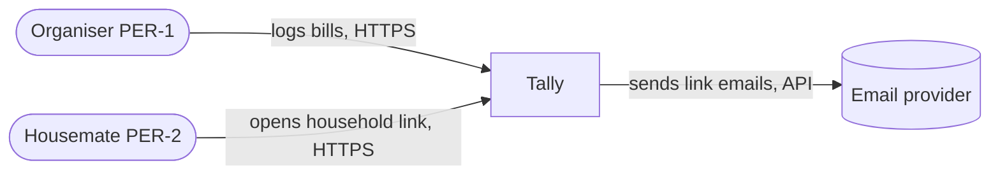
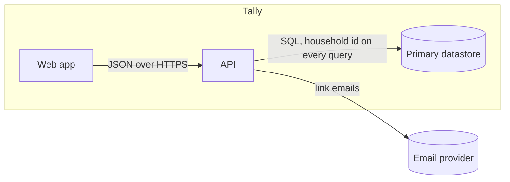
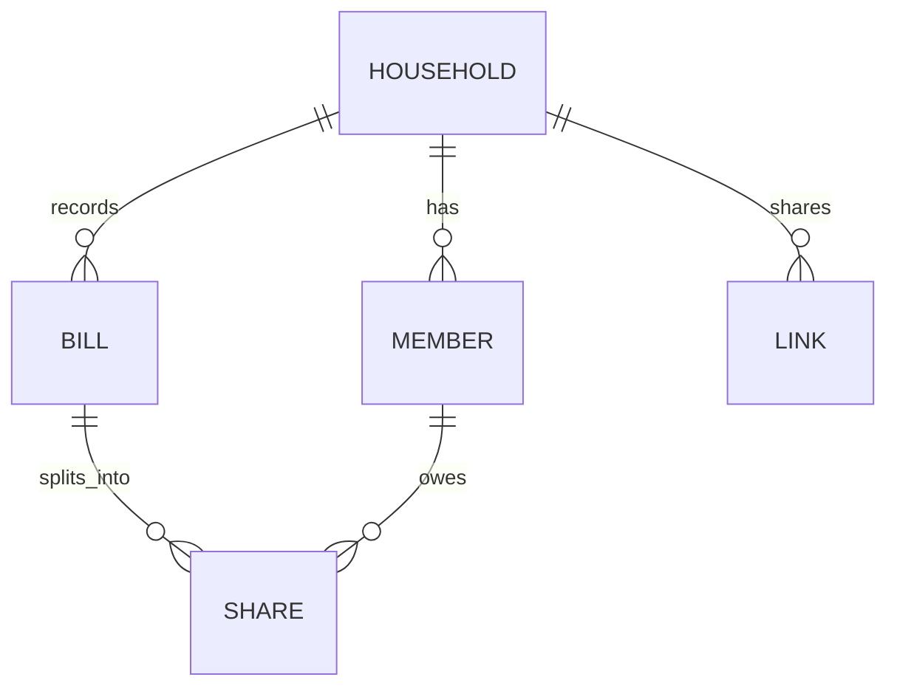

# Architecture — Tally

<!-- From skills/choosing-architecture/references/architecture-template.md. Fictional sample data. -->

## Quality attributes (ranked)

| Rank | Scenario (source · stimulus · environment · artifact · response · measure) | NFR | ADR |
|---|---|---|---|
| 1 | anyone holding a link · requests a household's bills · after the link was forwarded or revoked · the household API · returns only that household's data, or nothing once revoked · 0 cross-household rows | settle-up/NFR-2 | ADR-0001 |
| 2 | an organiser · saves a bill · on a phone over 4G at the evening peak · the bills API · acknowledges the bill · p95 < 300 ms at 20 rps | settle-up/NFR-1 | ADR-0002 |
| 3 | a housemate using a screen reader · settles a share · on a phone · the household page · completes CUJ-2 · 0 serious audit violations, keyboard-only completion | settle-up/NFR-3 | ADR-0003 |
| 4 | a housemate · opens the household link from a group chat · in the chat app's in-app browser · the household page · completes CUJ-2 · on every browser of the pilot's matrix | settle-up/NFR-4 | ADR-0004 |

## Stack

Pack: the stack pack's defaults (ADR-0002); a product pins that pack in its `toolkit.lock` beside the
harness. This example pins only the harness and a skill library, so `harness lock --check` needs
nothing outside the repository and one public source. Deviations: none.

## Context view

## Container view

The API owns all data; the household-id boundary in the repository layer is the one-way door (ADR-0001).

## Data model sketch

| Entity | Key | Owned by | Tenancy | Personal data | Retention | One-way? |
|---|---|---|---|---|---|---|
| Household | id | API | is the tenant | none | while active | yes |
| Member | id | API | household_id | name, email | deleted on request within 30 days | no |
| Bill | id + idempotency key | API | household_id | none | 2 years | yes |
| Link | token hash | API | household_id | none | until revoked | no |

## Fitness functions

| Decision | Check | Runs | Fails when |
|---|---|---|---|
| ADR-0001 | tenancy probe with two households over every list endpoint | CI | any foreign row is returned |
| ADR-0001 | dependency rule: only the repository layer imports the database client | CI | another module imports it |
| ADR-0002 | load test on the save path | CI | p95 over 300 ms at 20 rps |
| ADR-0003 | automated accessibility audit per flow | CI | a serious violation |
| ADR-0004 | CUJ-2 end to end on the device matrix | CI | any browser of the matrix fails the journey |
| all | decision-drift gate | CI | always-loaded text names a retired choice |
