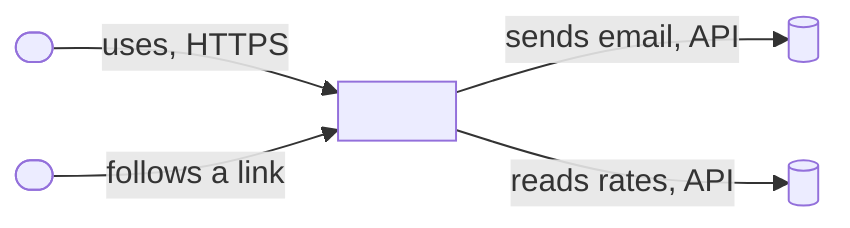
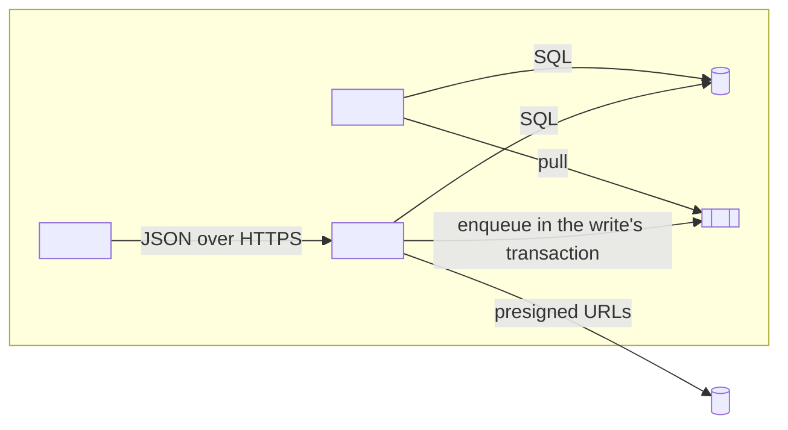
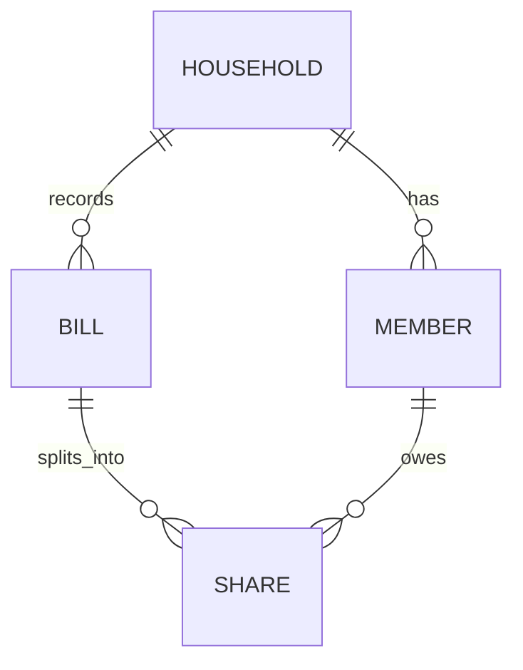

# Architecture — <product>

<!-- Copy to ARCHITECTURE.md (or docs/architecture.md). About two printed pages. Only the boxes and
     entities a decision depends on. Decisions live in DECISIONS.md; this file links them by id and
     never restates their reasoning. Mermaid renders in most forges; the text around each diagram
     must stand on its own. -->

## Quality attributes (ranked)

| Rank | Scenario (source · stimulus · environment · artifact · response · measure) | NFR | ADR |
|---|---|---|---|
| 1 | <a housemate> · <saves a bill> · <on a phone over 4G at peak> · <the balances API> · <returns the new shares> · <p95 < 300 ms at 20 rps> | my-epic/NFR-1 | ADR-0001 |
| 2 | <an attacker> · <requests another household's bills> · <with a valid session> · <the bills API> · <denies> · <0 cross-household rows> | my-epic/NFR-2 | ADR-0002 |

## Options (one table per decision with real alternatives)

| Option | Attribute 1 | Attribute 2 | Cost | Reversal cost | Verdict |
|---|---|---|---|---|---|
| <the pack's default> | <meets / misses, how> | <…> | <…> | <low / high> | <chosen / rejected> |
| <alternative> | <…> | <…> | <…> | <…> | <…> |

## Stack

Pack: `<name>@<version>` pinned in `toolkit.lock`. Deviations: <ADR ids, or "none">.

## Context view

<One line per arrow that is not obvious: what crosses it and who owns it.>

## Container view

<Which container owns which data; which arrows are one-way doors (ADR ids).>

## Data model sketch

| Entity | Key | Owned by | Tenancy | Personal data | Retention | One-way? |
|---|---|---|---|---|---|---|
| <Bill> | <id> | <API> | <household_id on every row> | <none> | <7 years> | <yes: others depend on its shape> |

## Fitness functions

| Decision | Check | Runs | Fails when |
|---|---|---|---|
| ADR-0001 | <performance budget test> | <CI, every PR> | <p95 over budget> |
| ADR-0002 | <permission matrix test> | <CI> | <a route returns another tenant's row> |
| all | <decision-drift gate> | <CI> | <always-loaded text names a retired choice> |
