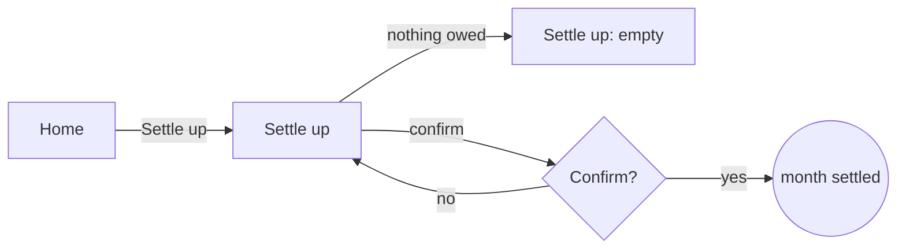

# Flow notation

Flows are written so they read in any Markdown viewer, diff cleanly, and parse as the `ux-flow`
contract's `Steps`. A diagram is optional and never the source of truth.

## Plain Markdown (the source of truth)

Numbered sub-items under `- **Steps:**`, one transition each:

| Symbol | Means | Example |
|---|---|---|
| `**Screen**` | a screen, dialog or page, in bold | `**Bills**` |
| `→ action →` | the user's action (or the system's response) and where it leads | `**Bills** → taps Add bill → **New bill**` |
| `?` | a decision; branches separated by `·` | `**New bill** ? amount valid → yes: **Bills** · no: **New bill** (field error)` |
| `⏹` | an exit: the journey's success, or leaving the flow | `**Settle up** → confirms → ⏹ month settled` |
| `↩` | back to an earlier step | `**Error** → Retry ↩ step 2` |
| `(state)` | the state shown on arrival, when it is not success | `**Bills** (empty)` |

Example:

```markdown
- **Steps:**
  1. **Home** → taps Settle up → **Settle up** (loading)
  2. **Settle up** ? any balance owed → yes: shows who owes whom · no: **Settle up** (empty)
  3. **Settle up** → confirms → **Confirm** dialog
  4. **Confirm** → confirms → ⏹ month settled, balances zero
```

Keep one transition per item and each item on one line. Three to eight steps per flow; more is
usually two flows.

## Mermaid (optional)

Add one only when the flow branches more than twice. Put it after the entry, in a fenced block, so the
parser ignores it:



If the diagram and the steps disagree, the steps win; fix the diagram.

## Information architecture

A `## Screens` list before the flows: each screen, where it is reached from, what it is for. A screen
reached from nowhere, or that serves no flow, is cut.

## Prototype handoff (tool-neutral)

| Option | When | What goes in `prototype` |
|---|---|---|
| A design tool's clickable prototype | a designer works in one; brand matters at this stage | the share URL (view access for the evaluator) |
| A clickable HTML prototype | no design tool; the evaluator walks with a browser | a repository path such as `docs/ux/prototypes/<epic>/index.html` |
| A throwaway branch | interaction is the risk (drag, live updates) | the branch name and the command to run it |

Whatever the medium, the prototype must:
- reach every step of every flow by clicking or keyboard;
- show all four states of each data screen (a toggle, a query parameter, or one page per state);
- carry no real personal data and no secrets;
- be thrown away or kept under `docs/ux/`; it is never merged as the implementation unless a task says so.

The building task's `inputs` cites the flow (`docs/ux/<epic>.md#ux-1`) and, when it helps, the
prototype path.
